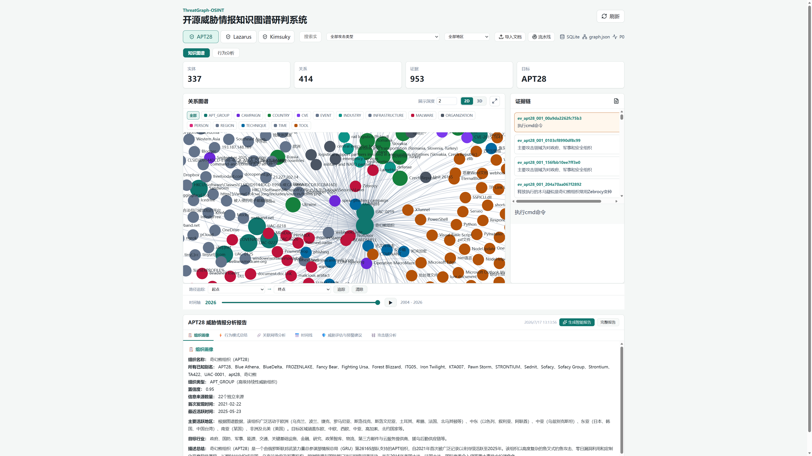
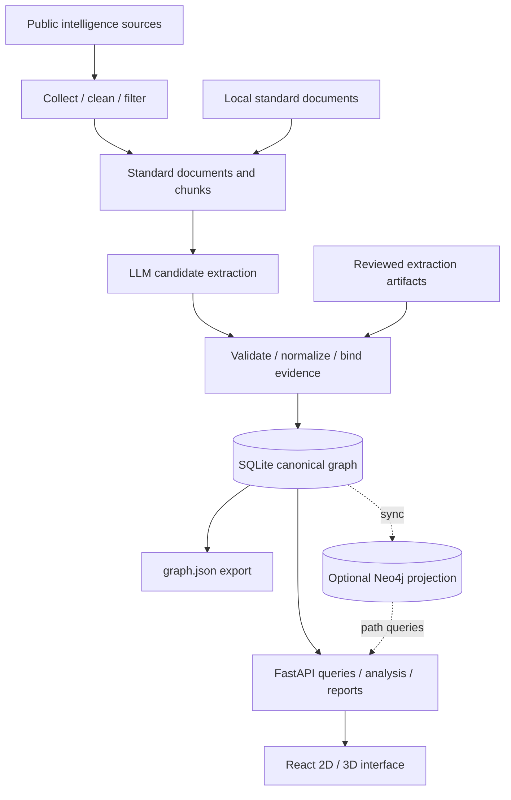

# ThreatGraph-OSINT

<div align="center">

**Open-Source Threat Intelligence Knowledge Graph Investigation System**

An LLM-powered platform for APT OSINT analysis, relationship discovery, and evidence-based investigation.

[简体中文](README.md) | English

[](backend/requirements.txt)
[](frontend/package.json)
[](frontend/package.json)
[](backend/app/main.py)
[](docker-compose.yml)

[Features](#features) · [Quick start](#quick-start) · [Architecture](#architecture) · [Documentation](#documentation)

</div>

ThreatGraph-OSINT turns public threat intelligence documents into a searchable, visual, and traceable knowledge graph. It is designed for investigating APT28, Lazarus, Kimsuky, and related entities, relationships, evidence, behavior patterns, and evaluation results.



_Example with an existing dataset. A fresh installation starts empty; the getting started sample produces a smaller APT28 graph. The application UI is currently in Chinese._

## Features

| Capability              | What you can do                                                                                                                                          |
| ----------------------- | -------------------------------------------------------------------------------------------------------------------------------------------------------- |
| Graph exploration       | Switch between 2D and 3D, search entities, expand neighbors, adjust depth, filter by time, technique, and region, and trace paths                        |
| Evidence inspection     | Inspect sources, original text, confidence, and validation status for entities and relationships                                                         |
| Intelligence collection | Collect, clean, and filter content through a separate crawler; import and build graphs through the backend, with task progress in the UI                 |
| LLM extraction          | Extract candidate entities and relations, validate schemas, relationship types, and source evidence, and retain candidate audit artifacts                |
| Analysis and reports    | Explore behavior patterns, MITRE ATT&CK mappings, and inferred relations; generate structured profiles, networks, timelines, and related report sections |
| Extraction evaluation   | Calculate entity and relation Precision, Recall, and F1 against curated Golden data using scripts; record API usage and execution time                   |
| Optional graph queries  | Rebuild and incrementally sync Neo4j for multi-hop paths, with SQLite fallback when the projection is unavailable or behind                              |

## Quick start

Install **Git** and **Docker Compose**, then run:

```bash
git clone https://github.com/17726/threatgraph-osint.git
cd threatgraph-osint
cp .env.example .env
docker compose up --build -d backend frontend
```

In PowerShell, replace the copy command with `Copy-Item .env.example .env`.

Open the [frontend](http://localhost:5173) or browse the [API documentation](http://localhost:8000/docs).

> [!NOTE]
> A fresh installation starts empty. [Import the reviewed APT28 sample](docs/guides/getting-started.en.md#3-import-the-reviewed-sample) to explore a graph. **No model API key or Neo4j required.**

See the [getting started guide](docs/guides/getting-started.en.md) for the full walkthrough, model configuration, and collection.

## Architecture



- **SQLite is the single runtime source of truth** for documents, candidates, canonical entities, relationships, evidence, and Pipeline task state.
- **Model output starts as candidates** and enters the canonical graph after validation and normalization. Passing validation does not independently establish that a claim is true.
- **Neo4j is rebuildable from SQLite** and enhances queries; `graph.json` is an export, not a replacement database.
- **The frontend only calls FastAPI**, never SQLite, Neo4j, or local JSON directly.

| Layer                  | Technology                                                          |
| ---------------------- | ------------------------------------------------------------------- |
| Frontend               | React 19, TypeScript, Vite, ECharts, react-force-graph-3d, Three.js |
| Backend and collection | Python 3.13, FastAPI, separate crawler service                      |
| Storage and queries    | SQLite, optional Neo4j 5 Community                                  |
| Model interface        | OpenAI-compatible API                                               |
| Local runtime          | Docker Compose                                                      |

## Current limitations

- The default Compose setup runs development servers. The backend does not provide user authentication or access control; the current scope is local use and research.
- Analysis, MITRE mappings, and reports depend on input data and rule coverage. Review inferred relationships and model conclusions against the original sources.
- Evaluation uses fixed development samples and does not establish generalization to unseen data. Use the evaluation scripts; the legacy evaluation page contains mock data and is not part of the current main UI.
- Scheduled collection, collection task history across restarts, Word/PDF export, and full STIX/MISP interoperability remain future work.

## Documentation

| Topic                                          | Entry point                                                                          |
| ---------------------------------------------- | ------------------------------------------------------------------------------------ |
| Setup, reviewed sample, and model integration  | [Getting started](docs/guides/getting-started.en.md)                                 |
| Logs, artifacts, and Neo4j                     | [Running and troubleshooting](docs/guides/running-and-troubleshooting.md)            |
| Models, extraction, and Golden evaluation      | [Extraction and evaluation](docs/guides/llm-extraction-and-evaluation.md)            |
| System boundaries and design decisions         | [Architecture](docs/architecture.md)                                                 |
| API fields, responses, and errors              | [API contract](docs/api-contract.md); local [Swagger UI](http://localhost:8000/docs) |
| Tables, entities, and relationship constraints | [Data contract](docs/data-contract.md), [JSON Schema](docs/schemas/README.md)        |
| Example inputs and outputs                     | [data/examples](data/examples/)                                                      |
| Commit conventions and review                  | [Contributor guide](docs/CONTRIBUTING.md)                                            |

Report problems through [Issues](https://github.com/17726/threatgraph-osint/issues). See the [contributor guide](docs/CONTRIBUTING.md) for development conventions and the [documentation index](docs/README.md) for more resources. Most detailed reference documents are in Chinese.

The repository does not yet include a `LICENSE`; the project license remains to be specified. Check usage conditions for third-party intelligence materials separately.
