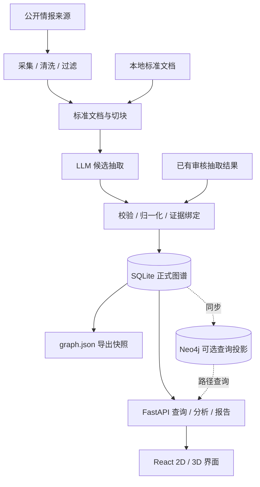

# ThreatGraph-OSINT

<div align="center">

**开源威胁情报知识图谱研判系统**

基于大模型的 APT 组织 OSINT 分析、关系发现与证据链研判平台

简体中文 | [English](README.en.md)

[](backend/requirements.txt)
[](frontend/package.json)
[](frontend/package.json)
[](backend/app/main.py)
[](docker-compose.yml)

[功能](#功能) · [快速开始](#快速开始) · [架构](#架构) · [文档](#文档)

</div>

ThreatGraph-OSINT 面向 APT28、Lazarus、Kimsuky 等目标组织，将公开情报文档转换为可检索、可视化、可追溯的威胁情报知识图谱，辅助分析人员查看实体关系、证据来源、行为模式和评测结果。


_已有数据集的界面示例；首次启动为空库，上手指南中的样例导入会生成一个较小的 APT28 图谱。_

## 功能

| 能力           | 可以做什么                                                                                  |
| -------------- | ------------------------------------------------------------------------------------------- |
| 图谱探索       | 切换 2D / 3D 视图，搜索实体、展开邻居、调整展示深度，按时间、技术和地区筛选，追踪节点间路径 |
| 证据追溯       | 查看实体与关系的来源、原文片段、置信度及校验状态，回到支持该关系的文档证据                  |
| 情报采集       | 独立 crawler 服务采集、清洗和过滤来源内容，后端统一导入与建图；界面展示阶段进度及任务事件   |
| LLM 抽取       | 从标准文档生成候选实体与关系，执行 Schema、关系类型和原文证据校验，保留候选审计工件         |
| 行为分析与报告 | 查看行为模式、MITRE ATT&CK 映射和推断关系，生成组织画像、关联网络、时间线等结构化报告       |
| 抽取评测       | 使用脚本对照人工 Golden 数据计算实体与关系的 Precision、Recall、F1，记录调用量和运行耗时    |
| 图查询增强     | 可选启用 Neo4j 全量重建、增量同步和多跳路径查询；投影不可用或未追平时回退到 SQLite          |

## 快速开始

准备 **Git** 和 **Docker Compose**，然后执行：

```bash
git clone https://github.com/17726/threatgraph-osint.git
cd threatgraph-osint
cp .env.example .env
docker compose up --build -d backend frontend
```

PowerShell 用户将复制命令换成 `Copy-Item .env.example .env`。

打开 [前端](http://localhost:5173)，API 文档位于 [Swagger UI](http://localhost:8000/docs)。

> [!NOTE]
> 首次启动为空库。按[导入审核样例](docs/guides/getting-started.md#3-导入审核样例)加载 APT28 数据后即可探索图谱，**无需模型 API Key 或 Neo4j**。

处理新情报、模型配置及完整操作见[上手指南](docs/guides/getting-started.md)。

## 架构



- **SQLite 是运行时唯一事实源**，保存文档、候选、正式实体、关系、证据与 Pipeline 任务状态。
- **模型输出先作为候选处理**，通过校验和归一化后才进入正式图谱。校验状态不等同于情报事实已经被独立证实。
- **Neo4j 可以从 SQLite 重建**，用于增强查询；`graph.json` 是导出快照，不替代数据库。
- **前端只调用 FastAPI**，不直接读取 SQLite、Neo4j 或本地 JSON。

| 层次       | 技术                                                                |
| ---------- | ------------------------------------------------------------------- |
| 前端       | React 19、TypeScript、Vite、ECharts、react-force-graph-3d、Three.js |
| 后端与采集 | Python 3.13、FastAPI、独立 crawler 服务                             |
| 存储与查询 | SQLite、Neo4j 5 Community（可选）                                   |
| 模型接口   | OpenAI-compatible API                                               |
| 本地运行   | Docker Compose                                                      |

## 当前边界

- 默认 Compose 使用开发服务器，后端尚未提供用户认证与权限管理；当前定位是本地运行与研究使用。
- 行为分析、MITRE 映射和报告受输入数据及规则覆盖范围影响，推断关系和模型结论需要结合原文复核。
- 评测结果来自固定开发样本，不能代表未知数据上的泛化效果；评测以脚本为入口，旧评测页面仍保留 Mock 数据，未接入当前主界面。
- 定时采集调度、跨重启的采集任务历史、Word/PDF 报告导出、完整 STIX/MISP 互操作仍属于后续工作。

## 文档

| 你想了解                     | 入口                                                                                |
| ---------------------------- | ----------------------------------------------------------------------------------- |
| 首次运行、审核样例与模型接入 | [上手指南](docs/guides/getting-started.md)                                          |
| 运行日志、产物目录与 Neo4j   | [运行与排障](docs/guides/running-and-troubleshooting.md)                            |
| 模型配置、抽取与 Golden 评测 | [LLM 抽取与评测](docs/guides/llm-extraction-and-evaluation.md)                      |
| 系统分层与设计决策           | [架构设计](docs/architecture.md)                                                    |
| API 字段、响应与错误码       | [API 契约](docs/api-contract.md)；运行后的 [Swagger UI](http://localhost:8000/docs) |
| 数据表、实体与关系约束       | [数据契约](docs/data-contract.md)、[JSON Schema](docs/schemas/README.md)            |
| 输入与输出样例               | [data/examples](data/examples/)                                                     |
| 提交约定与评审流程           | [贡献指南](docs/CONTRIBUTING.md)                                                    |

欢迎通过 [Issue](https://github.com/17726/threatgraph-osint/issues) 反馈问题；开发与提交约定见 [贡献指南](docs/CONTRIBUTING.md)。更多资料见 [文档索引](docs/README.md)。
