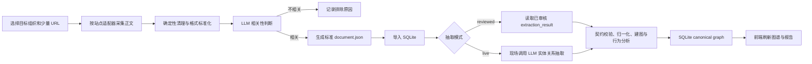

# 全链路演示路径

本文明确课程要求中的完整链路、当前前端已经真实打通的范围，以及数据采集组后续接入流水线时必须遵守的边界。演示时应按实际执行情况讲解，不把预生成产物描述成现场运行结果。

## 1. 课程目标链路



课程中的“全链路”是上述整条路径。前端不应直接运行脚本、读取文件或写 SQLite；它只调用 FastAPI 创建任务、查询状态和展示结果。

## 2. 建议的现场演示顺序

1. 选择 APT28、Kimsuky 或 Lazarus 中一个目标组织，并准备 2～3 个可稳定访问的页面；样本应同时包含明显相关和明显不相关内容。
2. 运行限量采集，展示来源适配器如何提取标题、正文、发布时间和来源 URL。现场不做全站爬取。
3. 展示确定性清理前后的正文差异，再展示 LLM 相关性判断及排除原因。
4. 将通过判断的内容转换为满足 `docs/schemas/document.schema.json` 的标准文档。
5. 在前端上传标准文档。前端先调用 `/documents/import`，成功或重复导入后都由用户显式调用 `/pipeline/run`。
6. 稳定演示默认选择 `reviewed`，证明已审核抽取结果能够被校验、归一化并写入 SQLite；若网络、密钥和费用条件允许，再单独选择 `live` 展示真实模型调用。
7. 前端轮询 `/pipeline/status/{job_id}`，显示等待、运行、成功或失败；关闭弹窗时停止轮询，但后端任务按服务生命周期继续安全完成。
8. 任务成功后刷新图谱和报告，并从实体、关系或证据回溯到本次导入文档。

## 3. 当前实现边界

本阶段已经真实打通：

```text
标准 document.json
  -> FastAPI 严格导入
  -> 后台 Pipeline 任务
  -> reviewed 已审核结果 或 live 现场 LLM
  -> extraction_result 契约校验
  -> OfflineExtractionPipeline
  -> SQLite canonical graph / 行为分析 / 报告
  -> 前端状态轮询与刷新
```

本阶段尚未接入前端任务的部分：

- 由 URL 或关键词启动的定向采集。
- 采集后的 LLM 相关性过滤。
- 将采集、清洗和相关性判断的实时进度写入同一个任务状态。

仓库已有的 `scripts/crawler_v1.py` 支持按关键词、按来源限量采集并生成标准文档，但目前只有确定性轻量清洗，没有完成 LLM 相关性过滤。数据组后续脚本应作为上游步骤接入同一应用编排，不再实现第二套抽取、建图或数据库写入逻辑。

## 4. 两种抽取模式

| 模式 | 真实行为 | 适用场景 | 失败条件 |
| --- | --- | --- | --- |
| `reviewed` | 读取与 `doc_id` 对应的已审核 extraction_result，再调用现有离线流水线 | 主演示、离线兜底、结果复现 | 缺少已审核结果或契约不一致 |
| `live` | 现场调用 `LLMExtractionService`，将结果写入临时文件并调用现有离线流水线 | 展示真实模型抽取能力 | 未配置密钥、外部服务失败、模型输出校验失败 |

`reviewed` 不会隐式回退到 `live`，`live` 也不会因为存在缓存而跳过模型调用。这样答辩时可以准确说明当前展示的是可复现结果还是现场模型结果。

## 5. 数据进入演示白名单的门槛

1. 文档必须通过 `document.schema.json` 和 `content_hash` 校验。
2. 来源 URL、来源类型、目标组织、获取时间和清洗 provenance 必须保留。
3. 相关性结论必须有唯一可信状态；如果 checkpoint 与文档 metadata 冲突，先由数据组确认，不能仅凭文件位于某个“filtered”目录就视为通过。
4. 清洗结果包含原文没有的片段、正文过长或模型判断异常时，不进入现场演示白名单。
5. 三类来源和三个目标组织是课程整体数据覆盖要求；单次现场任务只处理少量文档，以保证演示时间和外部依赖可控。

## 6. 后续采集步骤的接入契约

数据组脚本接入时只需向应用编排返回：

```json
{
  "documents": ["满足 document.schema.json 的对象"],
  "discarded": [
    {
      "source_url": "https://example.com/irrelevant",
      "reason": "irrelevant",
      "model": "实际使用的模型标识"
    }
  ]
}
```

通过相关性判断的 `documents` 继续调用现有文档导入与 Pipeline API；`discarded` 只用于演示过滤效果和审计，不进入 canonical graph。
